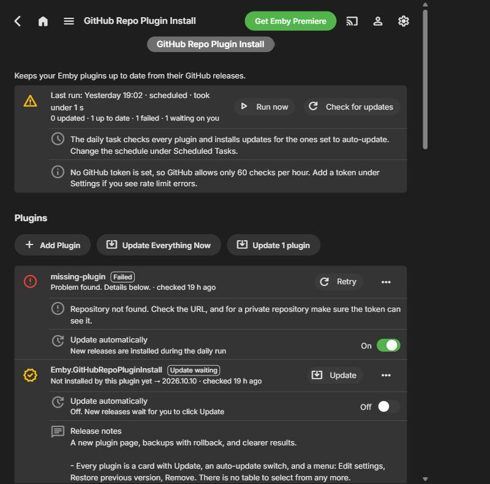
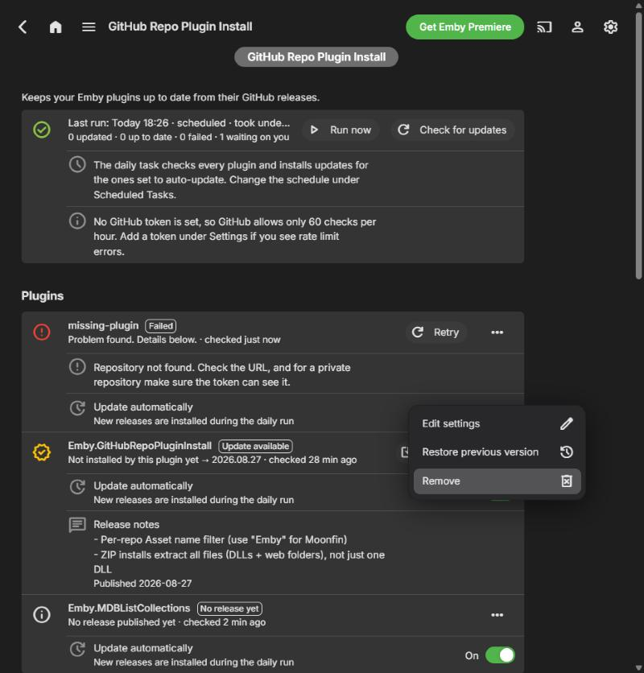
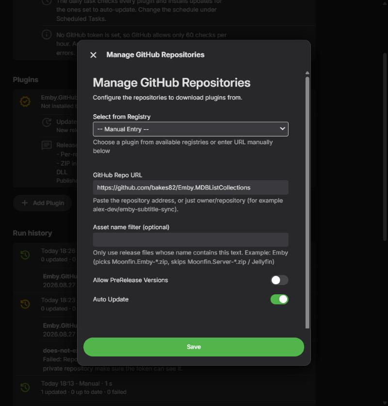
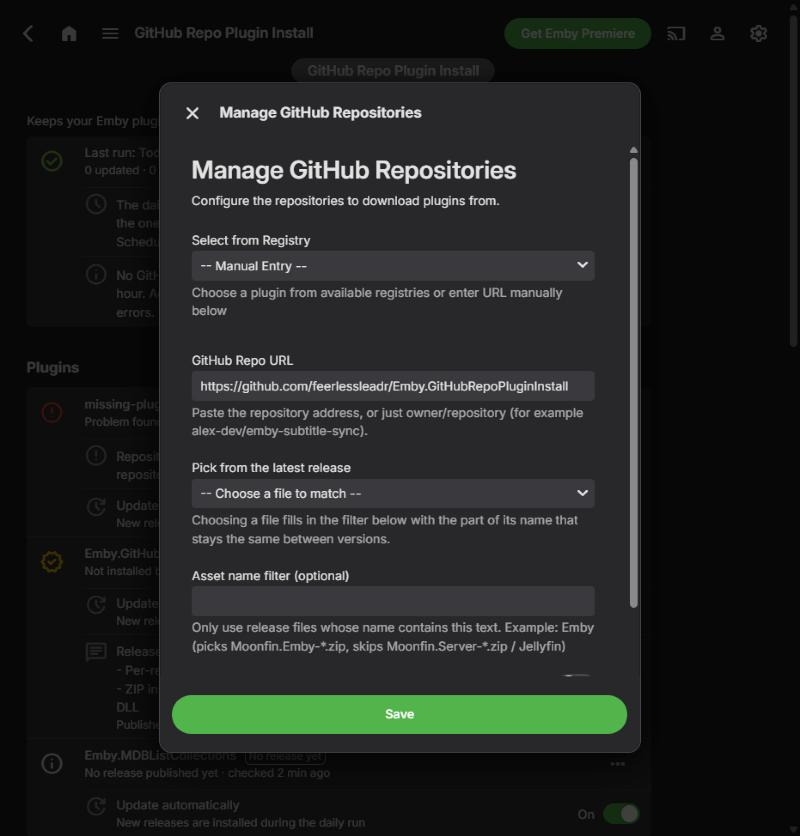
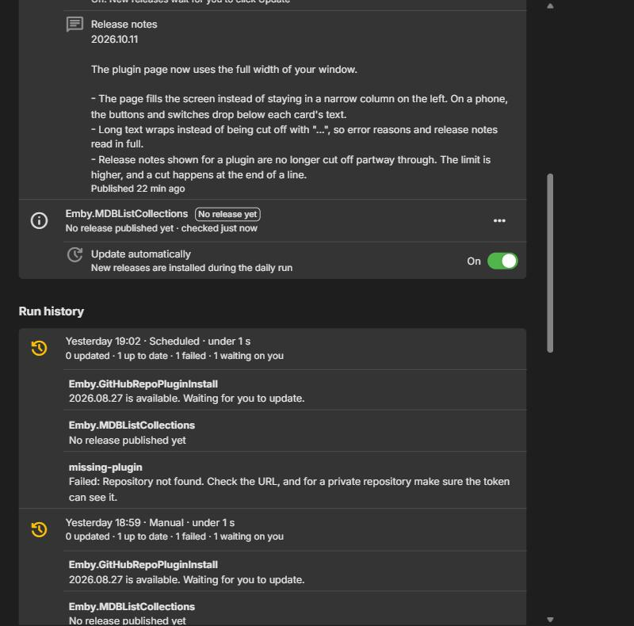
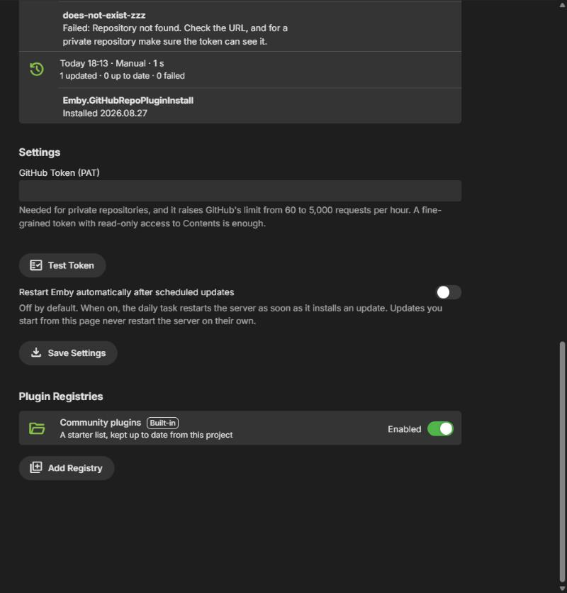
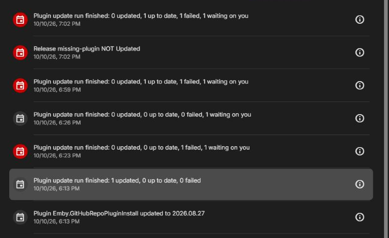
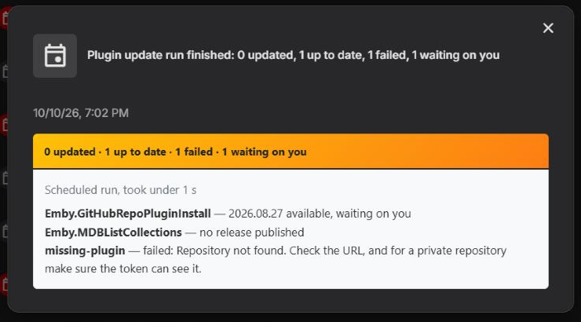

# GitHub Repo Plugin Installer

Installs and updates Emby plugins straight from their GitHub releases. Add a repository once and the plugin checks it every day, installs new releases, keeps a copy of what it replaced, and shows you what happened.

A release is installed when it contains a **.dll** asset, or a **.zip** asset that contains a .dll (GitHub's automatic source-code zips are ignored).

This is a fork of [bakes82/Emby.GitHubRepoPluginInstall](https://github.com/bakes82/Emby.GitHubRepoPluginInstall). Issues and releases for this version live in [feerlessleadr/Emby.GitHubRepoPluginInstall](https://github.com/feerlessleadr/Emby.GitHubRepoPluginInstall).

## What you see on the plugin page

The top of the page tells you what needs attention before anything else.

- **Restart needed** appears after an update is installed. It lists each plugin and its versions (`Subtitle Sync 2.3.0 → 2.4.1`) and has a **Restart now** button. It clears itself once Emby has restarted.
- **Last run** shows when the last update run happened, whether the daily task or you started it, how long it took, and the counts: updated, up to date, failed, and waiting on you. **Run now** starts a run in the background and **Check for updates** looks for new releases without installing anything. While a run is going the card shows a progress bar; click **Refresh** to update it.
- **Plugins** has one card per repository, with problems first, then updates, then everything that is up to date. Each card shows the installed and latest version, when it was last checked, and a plain-language reason if something failed. Everything you can do to a plugin is on its card, so there is no table to select from:
  - **Update** (or **Retry** after a failure) installs the newest release.
  - The **Update automatically** switch under the card turns auto-update on or off for that plugin.
  - The **⋯** menu has **Edit settings**, **Restore previous version** and **Remove**.
  - Release notes sit underneath.
  - **Update N plugins**, above the cards, appears only while at least one plugin shows an update. It installs just those plugins, including ones with auto-update off, and leaves the rest alone. It asks first and names them.
- **Run history** keeps the last 10 runs with the result for each plugin. The Emby activity log gets one summary entry per run, plus an entry for each plugin that was installed or failed. Plugins that were already up to date no longer add an entry each.

Opening the page never contacts GitHub. It shows what the last check found, so it opens instantly and doesn't use up your request allowance.

## Setting up

### GitHub token (optional, recommended)

Public repositories work without a token, but GitHub then allows only 60 requests per hour. A token raises that to 5,000 and is required for private repositories. Use **Test Token** on the plugin page to check it. It tells you if the token works, how many requests you have left, and warns if the token is broader than it needs to be.

**Recommended: a fine-grained token with read-only access**

1. GitHub, then your profile picture, then **Settings**, then **Developer settings**.
2. **Personal access tokens**, then **Fine-grained tokens**, then **Generate new token**.
3. Under **Repository access**, choose **Public repositories (read-only)**, or **Only select repositories** and pick the private ones you need.
4. Under **Repository permissions**, set **Contents** to **Read-only**. Metadata is added automatically.
5. Paste the token into the plugin page and click **Save Settings**.

A classic token with the `repo` scope also works, but it can read all of your private repositories, so only use one if you have to.

**How the token is stored.** It is encrypted with AES-256-GCM. The key is a random value kept in `github-repo-plugin-install.key` in Emby's data folder, separate from the settings file. This keeps the token out of reach if the settings file is shared or backed up on its own. It does not protect against someone who can read both files as the Emby user. Tokens saved by earlier versions are converted automatically. If the key file is lost, the token can't be read and you'll need to enter it again.

### Adding repositories

1. Click **Add Plugin**, under the plugin cards.
2. Pick a plugin from the registry list, or type the repository. All of these work: `owner/repository`, `https://github.com/owner/repository`, a `.git` address, or a link to the releases page. The address is saved in one standard form.
3. **Auto Update** installs new releases during the daily run. With it off, the plugin still checks the repository and shows the update, and you install it with the **Update** button.
4. **Allow PreRelease Versions** includes releases marked as pre-releases.
5. **Asset name filter** is for releases that ship several files for different servers. When you edit a repository you can pick one of the files on the latest release, and the filter is filled in with the part of the name that stays the same between versions.

The repository is looked up as soon as you save it, so its card shows a real status straight away.

### The installer's own entry

The first time the page is opened, this repository is added to your list so the installer can update itself. It's added once; if you remove it, it stays removed. If your list already has a plugin with the same repository name from another owner, it isn't added, because two entries writing the same file would undo each other.

## Updating

- **Daily task** (Scheduled Tasks, "Update Plugins From Github Repos") installs updates for repositories with Auto Update on and checks the rest.
- **Restart behavior.** The daily task never restarts Emby unless you turn on *Restart Emby automatically after scheduled updates*. Updates you start from the page never restart the server on their own. Either way the **Restart needed** banner shows what changed.
- **Update Everything Now** (under the cards) checks every repository on GitHub again and installs the newest release of each, including ones with Auto Update off and ones that have not been checked yet. To update only the plugins that already show an update, use **Update N plugins** above the cards.

### Backups and rollback

Before a plugin file is replaced, the current one is copied to `plugins/plugin-backups/` (as `.bak` files, so Emby never loads them). The three newest backups of each plugin are kept.

To roll back, open the ⋯ menu on the plugin's card and choose **Restore previous version**. Auto-update is switched off for that plugin so the next daily run doesn't put the newer version back. Turn it on again with the **Update automatically** switch when you're ready. If you restore straight after an update, before restarting, nothing needs restarting because the old file matches what is still running.

For plugins delivered as a zip, only the plugin's main DLL is backed up and restored, not the other files in the zip.

### Integrity checks

If a release publishes a SHA-256 hash, the download is checked against it before it replaces anything. The plugin uses GitHub's own digest for the asset when there is one, or a `.sha256` file or `SHA256SUMS` file in the release. A mismatch stops the install and leaves your working plugin untouched. Releases that publish no hash are still installed; the activity log notes that they weren't verified.

### Locked files

On Windows a plugin Emby has loaded can't always be overwritten. When that happens the old file is renamed to `*.old` and the new one takes its place. Leftover `.old` files are removed at the start of the next run.

## Plugin registries

The built-in registry lists community plugins and is read from this repository, so new entries appear without a new installer release. If GitHub can't be reached, a copy built into the plugin is used. You can add your own registries under **Plugin Registries**, where each registry is a card with an **Enabled** switch and a ⋯ menu to edit or remove it (the built-in one can be switched off but not removed). The same plugin listed by several registries appears once, even if the URLs are written differently.

### Creating your own registry

Host a `plugins.json` file anywhere that serves it as plain JSON, such as the raw URL of a file in a GitHub repository or a Gist:

```json
{
  "name": "My Plugin Registry",
  "description": "Custom collection of Emby plugins",
  "plugins": [
    {
      "name": "My Awesome Plugin",
      "description": "Does something awesome for Emby",
      "url": "https://github.com/username/my-awesome-plugin"
    }
  ]
}
```

Then use **Add Registry** and enter its name and raw URL.

## Screenshots

Taken on Emby Server 4.10.1 with three example plugins: one that failed, one with an update waiting, and one whose repository has no release yet.

**The plugin page.** The last run, then a card for each plugin, problems first.



**Everything for a plugin is on its card.** The ⋯ menu has Edit settings, Restore previous version and Remove.



**Adding a plugin.** Pick one from a registry, or type `owner/repository`.



**Editing a plugin.** Pick one of the files on the latest release to fill in the asset filter.



**Run history and settings.**





**The Emby activity log.** Each run adds one summary entry, plus an entry for each plugin that was installed or failed.





## Troubleshooting

Failed plugins show the reason on their card. The common ones:

- **"GitHub rejected the token"** (401): the token expired or was revoked. Click **Test Token**, and paste a new one if it fails.
- **"GitHub's request limit was reached"**: it tells you when the limit resets. Adding a token raises the limit from 60 to 5,000 requests per hour.
- **"GitHub denied access"** (403): for a private repository, the token needs read access to its contents.
- **"Repository not found"** (404): check the address. For a private repository, make sure the token can see it.
- **"has no .dll or .zip file"**: the release only has source code or other files. If you set an asset filter, check that it matches a file name on the release.
- **"Checksum mismatch"**: the download didn't match the hash the release publishes, so nothing was installed. Try again; if it keeps happening, the release may have been changed after it was published.

## Developing

```
dotnet build Emby.GitHubRepoPluginInstall.sln
dotnet test Emby.GitHubRepoPluginInstall.Tests
```

### Releasing

Pushing a version tag builds the plugin on GitHub and publishes a release with `Emby.GitHubRepoPluginInstall.dll` attached. Installers that follow this repository pick it up on their next run, including this plugin's own self-update.

```
git tag -a 2026.10.10 -m "What changed in this release"
git push origin 2026.10.10
```

- Tags are dates like `2026.10.10`, or `2026.10.10.1` for a second release on the same day. A leading `v` is allowed. The DLL's version is taken from the tag.
- The release notes are the tag's message. A tag made without `-a` has no message, so GitHub writes the notes from the commits since the last release.
- The tests run first, and nothing is published if one fails. The workflow is in [`.github/workflows/release.yml`](.github/workflows/release.yml), and its progress is under the repository's **Actions** tab.
- Only the DLL is attached, because the installer picks the first `.dll` on a release.
- Tags can't be re-used. To redo a release, delete the release and the tag, then tag again.

The tests run whole update runs against a fake GitHub with real temporary folders, including replacing a DLL that is loaded and locked. The page layout itself is built from Emby's own controls and has to be looked at inside a running Emby server.

## Support

For issues, feature requests, or questions, open an issue at [feerlessleadr/Emby.GitHubRepoPluginInstall](https://github.com/feerlessleadr/Emby.GitHubRepoPluginInstall/issues).
